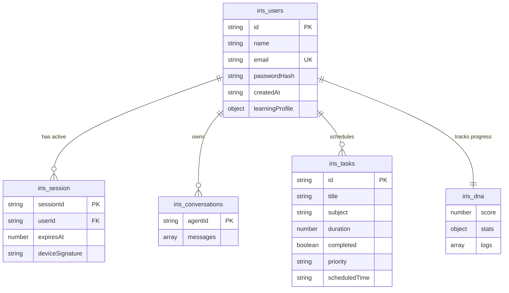
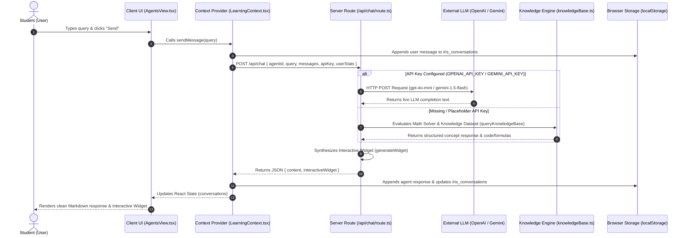
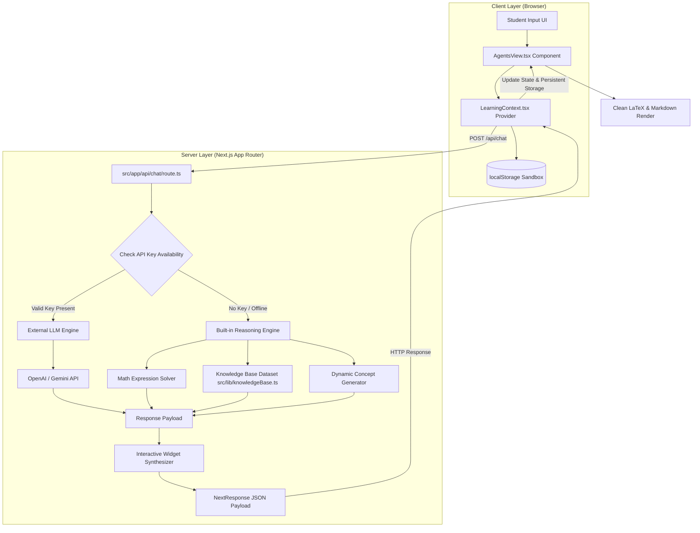

# Technology Stack & Architecture - IRIS Study OS

This document outlines the technologies, frameworks, libraries, APIs, database schemas, fields, system flow diagrams, and architecture implemented in the **IRIS (Intelligent Responsive Individualized Study Ecosystem)** project.

---

## 1. Frontend

* **Core Framework**: Next.js v16.2.9 (App Router layout configuration).
* **Library**: React v19.2.4 (Virtual DOM, Client-side Hooks, and State Providers).
* **Styling (CSS)**: Vanilla CSS & Tailwind CSS v4.0 (integrated via `@tailwindcss/postcss` using CSS variables and `@theme` directives), custom CSS class styles for visual glassmorphism and keyframe animations.
* **Animation**: Framer Motion (`framer-motion` v12.40.0) for step wizard transitions, spot tour highlight layouts, settings slide drawers, and alert cards.
* **State Management**: React Context API (`LearningContext.tsx`) for global state management, and React Hooks (`useState`, `useEffect`, `useRef`, `useContext`) for component-level reactivity.
* **Routing**: Client-side conditional rendering routing (managed via tab state hooks in `src/app/page.tsx`).
* **Form Validation**: Client-side regex checking (for email syntax verification), length restrictions (for 10-digit mobile numbers), slide puzzle CAPTCHAs, and password strength estimators.
* **Icons**: Lucide React (`lucide-react` v1.21.0) for vector icons across navigations, tabs, and alerts.
* **Visualizations & Renderers**:
  * Custom `FormattedMessage` & `parseInlineFormatting` LaTeX clean math parser.
  * Custom SVG vector canvas charts for Learning DNA history progression logs.
  * Interactive UI Widgets: Mathematics Chalkboard, Code Sandbox Editor, Science Simulation Lab, Rhetoric Reviewer, Career Path Roadmap, and Citation Generator.

---

## 2. Backend & API Server

* **Server Route Handlers**: Next.js App Router API Route (`src/app/api/chat/route.ts`).
* **Dual-Engine Architecture**:
  1. **External LLM Provider Engine**: Executes live HTTP calls to OpenAI (`gpt-4o-mini`) or Google Gemini (`gemini-1.5-flash`) when server environment variables (`OPENAI_API_KEY`, `GEMINI_API_KEY`) or client keys are active.
  2. **Built-in Subject Reasoning Engine**: Self-contained NLP dataset (`src/lib/knowledgeBase.ts`) executing mathematical calculation, equation isolation, calculus power-rule derivatives, and domain-specific topic generation offline.
* **Middleware & Gating**: Server-side placeholder key detection (`isPlaceholderKey`) and safe fallback routing.

---

## 3. Database Schema & Fields Specification

The IRIS application utilizes a hybrid local-first persistence model (`localStorage` sandbox) paired with a server-side knowledge repository engine (`src/lib/knowledgeBase.ts`).

### 3.1 User Profile Table (`iris_users`)
Stores registered user credentials, encrypted security hashes, and study preferences.

| Field Name | Data Type | Key Type | Description / Constraints |
| :--- | :--- | :--- | :--- |
| `id` | `String` | **PK** | Unique identifier (e.g. `"usr_101"`) |
| `name` | `String` | | Full user display name (e.g. `"Jane Doe"`) |
| `email` | `String` | **Unique** | Validated email address format |
| `passwordHash` | `String` | | Cryptographic SHA-256 hash generated via Web Crypto API |
| `createdAt` | `String (ISO)` | | Registration timestamp |
| `learningProfile` | `Object` | | Student metadata configuration: |
| ↳ `primaryGoal` | `String` | | Target objective (e.g. `"Software Engineering"`) |
| ↳ `learningStyle` | `String` | | Preferred mode (e.g. `"Visual Chalkboard"`) |
| ↳ `dailyStudyMinutes`| `Number` | | Daily target study duration in minutes (e.g. `45`) |
| ↳ `tutorTone` | `Enum` | | Tone: `"Encouraging"` \| `"Academic"` \| `"Socratic"` |
| ↳ `explanationDetail`| `Enum` | | Detail level: `"Concise"` \| `"Normal"` \| `"Detailed"` |
| ↳ `skillLevel` | `Enum` | | Level: `"Beginner"` \| `"Intermediate"` \| `"Advanced"` |

### 3.2 Authentication Sessions Table (`iris_session`)
Manages active login tokens and security expiration bounds.

| Field Name | Data Type | Key Type | Description / Constraints |
| :--- | :--- | :--- | :--- |
| `sessionId` | `String` | **PK** | Unique session identifier |
| `userId` | `String` | **FK** | References `iris_users.id` |
| `expiresAt` | `Number` | | Expiration epoch timestamp (in milliseconds) |
| `deviceSignature` | `String` | | User-agent device signature hash |

### 3.3 AI Tutor Conversations Table (`iris_conversations`)
Stores full message threads and interactive widget states for each AI mentor persona.

| Field Name | Data Type | Key Type | Description / Constraints |
| :--- | :--- | :--- | :--- |
| `agentId` | `String` | **PK (Map)** | Mentor ID: `"math"` \| `"science"` \| `"code"` \| `"lit"` \| `"career"` \| `"research"` |
| `messages` | `Array<Message>`| | Ordered thread of dialogue objects: |
| ↳ `id` | `String` | **PK** | Unique message ID |
| ↳ `sender` | `Enum` | | Origin: `"user"` \| `"agent"` |
| ↳ `agentId` | `String` | | Active mentor identifier |
| ↳ `content` | `String` | | Message body formatted in Markdown & LaTeX |
| ↳ `timestamp` | `String` | | Human-readable time label (e.g. `"09:18 PM"`) |
| ↳ `moodDetected` | `String` | | Student mood tag (e.g. `"Focused"`, `"Confused"`) |
| ↳ `interactiveWidget`| `Object` | | Optional rendered widget payload: |
| &nbsp;&nbsp;&nbsp;&nbsp;↳ `type` | `String` | | Widget type: `"chalkboard"` \| `"code_editor"` \| `"simulation"` \| `"grammar_checker"` \| `"career_roadmap"` \| `"citation_generator"` |
| &nbsp;&nbsp;&nbsp;&nbsp;↳ `data` | `Object` | | Contextual widget parameters (code snippets, steps, citations) |

### 3.4 Study Planner Tasks Table (`iris_tasks`)
Stores user study tasks, deadlines, and priorities.

| Field Name | Data Type | Key Type | Description / Constraints |
| :--- | :--- | :--- | :--- |
| `id` | `String` | **PK** | Unique task identifier |
| `title` | `String` | | Task description title |
| `subject` | `String` | | Related subject (e.g. `"Mathematics"`, `"Coding"`) |
| `duration` | `Number` | | Planned duration in minutes (e.g. `30`) |
| `completed` | `Boolean` | | Completion status flag (`true` / `false`) |
| `priority` | `Enum` | | Priority level: `"low"` \| `"medium"` \| `"high"` |
| `scheduledTime` | `String` | | Scheduled time label (e.g. `"18:00"`) |

### 3.5 Learning DNA Progress Table (`iris_dna`)
Tracks cognitive progress metrics and historical activity scores.

| Field Name | Data Type | Key Type | Description / Constraints |
| :--- | :--- | :--- | :--- |
| `score` | `Number` | | Overall DNA score (0–100) |
| `stats` | `Object` | | Sub-metric scores: |
| ↳ `comprehension` | `Number` | | Score value (0–100) |
| ↳ `learningSpeed` | `Number` | | Score value (0–100) |
| ↳ `retentionRate` | `Number` | | Score value (0–100) |
| ↳ `motivation` | `Number` | | Score value (0–100) |
| `logs` | `Array<ProgressLog>`| | Historical daily score logs (`id`, `date`, `score`, `activity`) |

### 3.6 Server Knowledge Base Dataset (`src/lib/knowledgeBase.ts`)
Pre-populated multi-subject dataset powering offline reasoning.

| Field Name | Data Type | Key Type | Description / Constraints |
| :--- | :--- | :--- | :--- |
| `keywords` | `Array<String>` | | Trigger lookup terms (e.g. `["constructor"]`, `["linkedlist"]`) |
| `title` | `String` | | Topic title header |
| `category` | `Enum` | | Category: `"cs"` \| `"math"` \| `"science"` \| `"lit"` \| `"career"` \| `"research"` |
| `response` | `String` | | Full educational Markdown content payload with code/formulas |

---

## 4. Entity Relationship (ER) Diagram

---

## 5. System Execution & Data Flow Diagram

The following flow diagram illustrates the end-to-end processing pipeline when a user submits a query to any of the 6 AI Mentor personas:

---

## 6. Comprehensive System Architecture Flow Diagram

---

## 7. Security & Encryption

* **Password Encryption**: Native Web Crypto API (`crypto.subtle.digest`) applying SHA-256 cryptographic hashing.
* **API Key Security**: Server-side processing inside `src/app/api/chat/route.ts` ensures API credentials (`OPENAI_API_KEY`, `GEMINI_API_KEY`) remain secret and are never exposed in client JavaScript bundles.
* **Rate Limiting & Lockout**: Lockdown of form submissions after 5 consecutive incorrect inputs.
